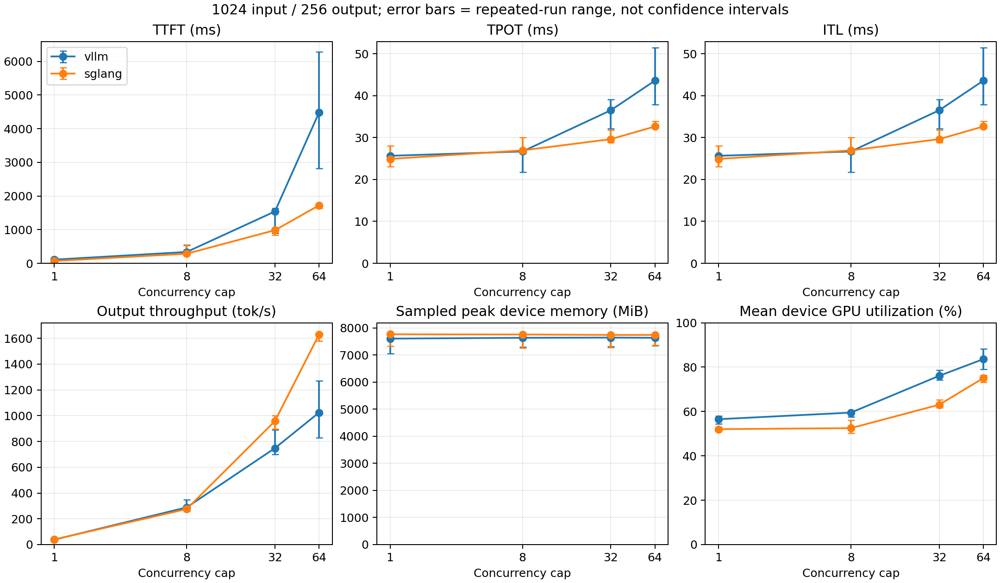
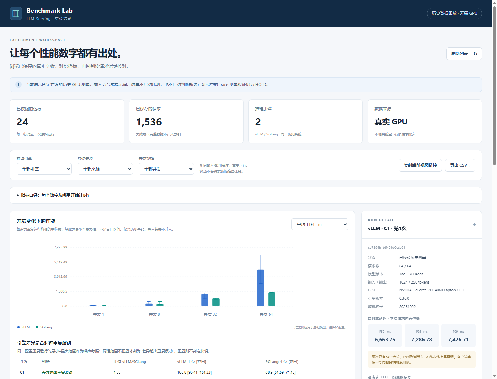

# LLM Serving Benchmark Lab

**面向大语言模型推理服务的性能评测与实验分析工具。**

这个项目从一个实际问题出发：同一个模型换用不同推理引擎或请求负载后，响应时间和吞吐会怎样变化？测试条件是否一致、原始数据是否完整、测到的变化是否只是运行波动？

目前提供 Python 命令行压测、实验脚本和本地只读结果浏览器，支持 vLLM / SGLang 的受控测试、结果校验与图表展示。项目同时作为软件工程本科毕设底座，以及性能退化分析的研究实验平台。

> **当前阶段：可运行的 Benchmark 工程与研究原型。** 自动瓶颈归因尚未实现；trace 测量可信度仍在验证。CPU 测试、合成响应与真实 GPU 测量分别记录，没有将它们混作性能结果。

## 建议先看

- [项目介绍与导师阅读入口](docs/PROJECT_OVERVIEW.md)
- [参赛方向与待补材料](docs/COMPETITION_READINESS.md)
- [固定并发对比报告与图表](reports/001-concurrency-study.md)
- [最新研究状态与证据](docs/RESEARCH_STATUS.md)
- [本地演示与验收步骤](docs/LOCAL_DEMO.md)
- [公开快照范围](docs/PUBLICATION.md)

## 当前能力

| 模块 | 已有实现 | 边界 |
| --- | --- | --- |
| 推理服务接入 | vLLM、SGLang 的 OpenAI-compatible completion 服务；统一客户端与配置 | 需要各自安装引擎，并明确模型、版本和启动参数 |
| 受控压测 | 固定并发、重复运行、预热、输入/输出长度校验；研究脚本含固定到达率与多阶段回放 | 研究脚本部分绑定历史本机路径，需要适配 |
| 指标与数据 | TTFT、TPOT、ITL、输出吞吐、请求延迟、GPU采样及可得的服务端指标 | 各指标测量边界不同，不把观测区间当作GPU纯执行时间 |
| 结果校验 | 检查失败请求、长度、缺失/非有限数值、配置一致性；保存原始记录与哈希 | 哈希核对不等于研究假设成立 |
| 可视化 | CSV / JSON / Markdown 报告、SVG / PNG 图表；FastAPI/SQLite本地结果浏览器 | Web界面只读；任务创建、worker和在线压测尚未接入 |
| 测量补救 | A/A负控、绝对时钟记录、独立资源采集、异常清理与CPU定时探针 | 未得出trace开销稳定或自动诊断有效的结论 |

## 已有报告示例

下图来自仓库中的历史固定并发实验，原始结果和实验条件见对应报告。图中的结果只适用于当时的单机、模型与配置，不代表所有硬件上的引擎排名。



## 运行与检查

### 无需GPU的本地演示

```bash
python -m pip install -r web-requirements.txt
python -m benchmark_lab
```

浏览器打开 `http://127.0.0.1:8765`，可筛选引擎/并发、查看单次运行的P50/P95/P99与请求序列、下载原始文件及CSV。引擎对比只在差异超出同配置重复运行的范围时才给出判断，范围重叠时明确“不判定快慢”。单次运行可展开请求时间线（客户端等待 / 等待首 token / 生成三段，加同时在途请求数），页面附指标口径说明，当前视图可复制为链接分享。Windows也可运行 `scripts/start-demo.ps1` 自动准备隔离的Web环境。页面读取现有历史结果，不下载模型、不发起推理。

自己用 `vllm bench serve --save-result --save-detailed` 跑出的结果，可以用 `python -m benchmark_lab import-vllm <文件> --engine vllm` 导入：原文件按字节保存并登记哈希，逐请求重算核对上报的 TTFT 汇总，失败、不完整或数值不一致的结果会被拒绝。详见[本地演示](docs/LOCAL_DEMO.md)。



### 命令行Benchmark与CPU检查

Python 3.12+。CPU校验可先运行：

```bash
python -m pip install -r report-requirements.txt
python -m unittest discover -s tests -v
```

有GPU和已安装的推理引擎时，按实际环境填写配置：

```bash
cp config.example.json config.local.json
# 修改模型snapshot/revision、Python环境、引擎仓库、服务命令与公共参数
python study.py config.local.json
```

也可以手动启动一个引擎后，单独执行客户端：

```bash
python lab.py run config.local.json --engine vllm
# SGLang单独启动后用 --engine sglang
```

两个引擎对比需分时使用同一GPU，保持模型、精度、长度、缓存和采样参数可比。不要同时启动两个服务来代替受控对照。详细流程和旧版运行说明见 [固定并发实验说明](docs/BASELINE_README.md)。模型权重、引擎环境和本机配置不包含在仓库中。

## 目录

```text
lab.py / study.py     压测、采集、校验与报告入口
tail_report.py        请求级延迟与尾部统计
tests/               CPU校验与报告测试
benchmark_lab/       只读结果API、可重建SQLite索引与 vllm bench 结果导入
web/                 本地结果浏览界面
web_tests/           API与证据访问测试
reports/             已保存报告、数据与图表
results/             历史固定并发报告引用的原始件
research/            文献、假设、实验脚本与选定证据
docs/                项目说明、当前状态、参赛准备
```

## 关于参赛与科研

拟与导师讨论以“LLM 推理服务自动化评测与实验分析工具”参与科研实验辅助方向。参赛重点是工程完整性、数据可信与可演示性；研究问题是否有创新性，仍需要文献与实验验证。没有声称已报名、已获参赛资格或获得奖项。

本仓库是已有本地项目的首次公开快照；原开发历史保留在本地。公开快照没有包含主机进程清单、会话交接和所有原始观测件。数据范围及哈希见 [公开说明](docs/PUBLICATION.md) 与 [文件清单](PUBLICATION_MANIFEST.json)。
