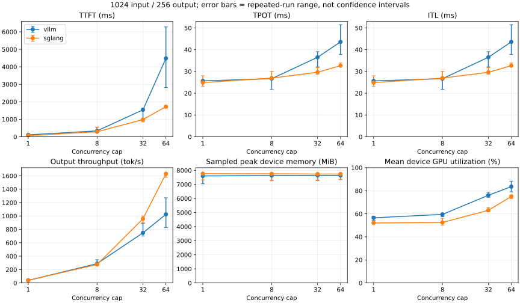

# 001 Concurrency Study

Verified workload: input=1024, output=256; concurrency=1/8/32/64.
Cell latency/throughput = median of repeated run means; GPU memory = sampled device peak.
GPU samples are aligned approximately using the client main-run marker and duration; device-wide, not process-specific.
This is a finite-request concurrency study, not proof of steady-state production capacity.

| Engine | C | TTFT ms | TPOT ms | ITL ms | Output tok/s | VRAM MiB | GPU % |
|---|---:|---:|---:|---:|---:|---:|---:|
| vllm | 1 | 108.797 | 25.656 | 25.656 | 38.265 | 7602.000 | 56.520 |
| vllm | 8 | 336.269 | 26.687 | 26.687 | 288.611 | 7632.000 | 59.491 |
| vllm | 32 | 1540.927 | 36.519 | 36.519 | 748.255 | 7639.000 | 76.061 |
| vllm | 64 | 4483.341 | 43.594 | 43.594 | 1024.441 | 7632.000 | 83.584 |
| sglang | 1 | 68.901 | 24.908 | 24.908 | 39.870 | 7762.000 | 52.032 |
| sglang | 8 | 283.826 | 26.950 | 26.950 | 275.718 | 7753.000 | 52.489 |
| sglang | 32 | 983.756 | 29.631 | 29.631 | 958.525 | 7738.000 | 63.048 |
| sglang | 64 | 1722.324 | 32.651 | 32.651 | 1630.277 | 7738.000 | 75.027 |

## Evidence and interpretation

Raw run directories: results/20261002T101126Z-vllm, results/20261002T122324Z-sglang
Metadata and all commands are preserved; compare commits, server parameters and logs before attributing differences.
This saturation workload uses synthetic random prompts and ignores EOS. It does not establish production SLA or model accuracy.
Bottleneck attribution is not automatic: inspect queue/prefill/decode logs, KV pressure, GPU clocks and Windows/WSL memory pressure.
A throughput plateau with increasing TTFT is a hypothesis of saturation, not proof of a specific kernel or scheduler bottleneck.

