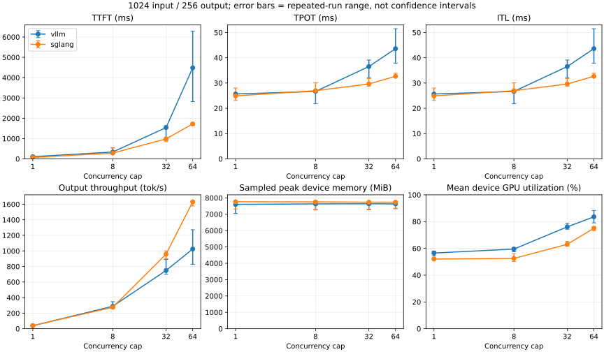

# 001 Concurrency Study

Verified workload: input=1024, output=256; concurrency=1/8/32/64.
Cell latency/throughput = median of repeated run means; GPU memory = sampled device peak.
GPU samples are aligned approximately using the client main-run marker and duration; device-wide, not process-specific.
This is a finite-request concurrency study, not proof of steady-state production capacity.

| Engine | C | TTFT ms | TPOT ms | ITL ms | Output tok/s | VRAM MiB | GPU % |
|---|---:|---:|---:|---:|---:|---:|---:|
| vllm | 1 | 108.797 | 25.656 | 25.656 | 38.265 | 7602.000 | 56.520 |
| vllm | 8 | 336.269 | 26.687 | 26.687 | 288.611 | 7632.000 | 59.491 |
| vllm | 32 | 1540.927 | 36.519 | 36.519 | 748.255 | 7639.000 | 76.061 |
| vllm | 64 | 4483.341 | 43.594 | 43.594 | 1024.441 | 7632.000 | 83.584 |
| sglang | 1 | 68.901 | 24.908 | 24.908 | 39.870 | 7762.000 | 52.032 |
| sglang | 8 | 283.826 | 26.950 | 26.950 | 275.718 | 7753.000 | 52.489 |
| sglang | 32 | 983.756 | 29.631 | 29.631 | 958.525 | 7738.000 | 63.048 |
| sglang | 64 | 1722.324 | 32.651 | 32.651 | 1630.277 | 7738.000 | 75.027 |

## Evidence and interpretation

Raw run directories: /home/dcl/projects/llm-serving-benchmark-lab/results/20261002T101126Z-vllm, /home/dcl/projects/llm-serving-benchmark-lab/results/20261002T122324Z-sglang
Metadata and all commands are preserved; compare commits, server parameters and logs before attributing differences.
This saturation workload uses synthetic random prompts and ignores EOS. It does not establish production SLA or model accuracy.
Bottleneck attribution is not automatic: inspect queue/prefill/decode logs, KV pressure, GPU clocks and Windows/WSL memory pressure.
A throughput plateau with increasing TTFT is a hypothesis of saturation, not proof of a specific kernel or scheduler bottleneck.

## Reproducible environment

| Item | Value |
|---|---|
| GPU | RTX 4060 Laptop; 8188 MiB; driver 616.64 |
| Model | Qwen/Qwen2.5-0.5B-Instruct; 7ae557604adf67be50417f59c2c2f167def9a775 |
| Runtime | PyTorch 2.13.0+cu130; Torch CUDA 13.0 |
| Workload | 64 requests per run, 3 repeats; seed 20261002; temperature 0; ignore EOS |
| Common server settings | float16; context 2048; memory fraction 0.45; TP=1; prefix cache off; CUDA graphs off |
| Client | Same runtime vLLM 0.30.0; installed distribution metadata 0.1.dev1+g157bcb7c4.d20260923 |
| vllm commit | ced6857afa0ea7b2e3f0846a62e1394e90f15607 |
| sglang commit | af5c0659c7c133b77aa0e1557c6db83a449d093d |

The model is identical, but implementations/backends differ: vLLM disables FlashInfer sampling; SGLang uses explicit Triton attention and PyTorch sampling. This is a comparison of these configurations, not their default or optimally tuned configurations. Full commands, package inventories and CUDA SDK version are in the JSON metadata and raw files.

## Observations and bottleneck hypotheses

- Observed vllm: output throughput rises from 38.26 to 1024.44 tok/s (26.77x for 64x the concurrency cap); TTFT rises from 108.80 to 4483.34 ms. Batching improves aggregate throughput while request latency increases; these observations do not isolate a scheduler or kernel cause.
- vllm at C64: repeated throughput range 827.42–1271.89 tok/s. Range bars show run variation, not statistical confidence intervals.
- Observed sglang: output throughput rises from 39.87 to 1630.28 tok/s (40.89x for 64x the concurrency cap); TTFT rises from 68.90 to 1722.32 ms. Batching improves aggregate throughput while request latency increases; these observations do not isolate a scheduler or kernel cause.
- sglang at C64: repeated throughput range 1577.79–1640.69 tok/s. Range bars show run variation, not statistical confidence intervals.

### Machine-state audit

| Engine | Run | Mean temperature C | Mean SM MHz | Mean power W |
|---|---|---:|---:|---:|
| vllm | c1-r0 | 83.94 | 2592.85 | 66.93 |
| vllm | c1-r1 | 84.25 | 2591.75 | 67.66 |
| vllm | c1-r2 | 84.10 | 2594.23 | 66.59 |
| vllm | c32-r0 | 84.36 | 2572.50 | 72.18 |
| vllm | c32-r1 | 83.53 | 2577.38 | 70.33 |
| vllm | c32-r2 | 84.79 | 2508.64 | 74.95 |
| vllm | c64-r0 | 84.24 | 2570.69 | 72.86 |
| vllm | c64-r1 | 85.00 | 2564.57 | 76.94 |
| vllm | c64-r2 | 85.70 | 2424.78 | 78.04 |
| vllm | c8-r0 | 83.62 | 2591.07 | 66.87 |
| vllm | c8-r1 | 82.00 | 2569.53 | 62.94 |
| vllm | c8-r2 | 84.29 | 2564.41 | 68.27 |
| sglang | c1-r0 | 82.77 | 2570.79 | 63.50 |
| sglang | c1-r1 | 82.90 | 2590.65 | 64.69 |
| sglang | c1-r2 | 84.57 | 2589.74 | 66.82 |
| sglang | c32-r0 | 82.97 | 2521.45 | 68.45 |
| sglang | c32-r1 | 82.62 | 2527.24 | 71.34 |
| sglang | c32-r2 | 85.09 | 2502.19 | 72.68 |
| sglang | c64-r0 | 83.83 | 2498.33 | 73.76 |
| sglang | c64-r1 | 83.61 | 2503.33 | 78.13 |
| sglang | c64-r2 | 84.32 | 2467.11 | 76.07 |
| sglang | c8-r0 | 82.14 | 2582.41 | 62.98 |
| sglang | c8-r1 | 81.91 | 2585.91 | 63.55 |
| sglang | c8-r2 | 84.46 | 2582.39 | 68.64 |

Observed vLLM C64 run-to-run differences are substantial. Temperature and clocks also vary; however faster runs do not consistently have higher clocks, so this is insufficient to attribute variation specifically to thermal throttling. No isolated profiler trace or throttling-reason experiment was run.
Hypothesis: increased batch size amortizes weight reads and launch overhead; the remaining latency/throughput trade-off may involve prefill scheduling and decode compute/memory limits. Verify with scheduler traces, prefill/decode timing and a targeted profile before changing scheduling, kernels or memory limits.
SGLang server logs report zero cached prompt tokens, confirming cache-off behavior on observed prefill requests. The run contains successful prefill/decode activity; this alone does not prove a particular bottleneck.
No KV exhaustion or OOM was observed in the successfully validated requests; absence of failures does not prove memory headroom for larger models/workloads.

### Limits on interpretation

- Engines ran sequentially, with a restart and a time gap; engine order and desktop GPU load were not controlled with paired alternation. Treat engine differences as descriptive results, not causal proof.
- C64 contains one finite wave of 64 requests. Higher throughput does not establish sustainable arrival rate, production p99 latency or an SLA.
- Device-wide memory includes Windows/WSL and other processes; sampled peak memory is not engine-only allocated VRAM. Temperature/power/clocks are observations, not controlled variables.
- Warmup was 16 separate requests; every measured request length was checked. Requests ignore EOS, so throughput is unrelated to model quality.
- This serving study does not benchmark the HiCache lookup PR or the P2P timeout fix; their feature paths are not enabled here.

## Evidence and interview draft

Engineering evidence: built one serving-benchmark pipeline using a shared official client; pinned model/runtime/engine commits; verified 1,536 measured requests (24 runs × 64), every prompt 1024 tokens and every output 256 tokens; recorded GPU telemetry and generated six-panel plots. This is assistant-implemented evidence, not a claim that the user independently implemented or explained it.
Interview outline: explain why actual token lengths, cache settings and engine build provenance need checking; describe the initial CUDA/JIT and health-timeout failures; explain why repeated-run ranges and device/thermal limits prevent declaring a general engine winner.
Maintainer feedback: no maintainer review of this benchmark lab yet; no upstream serving-performance PR or merged performance claim is implied.
